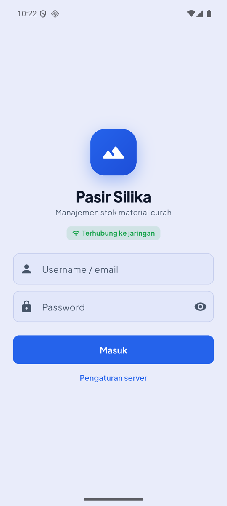
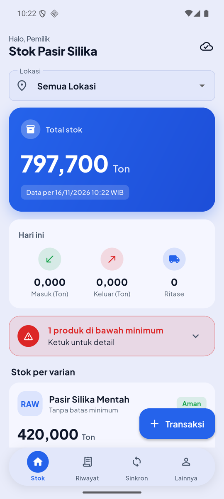
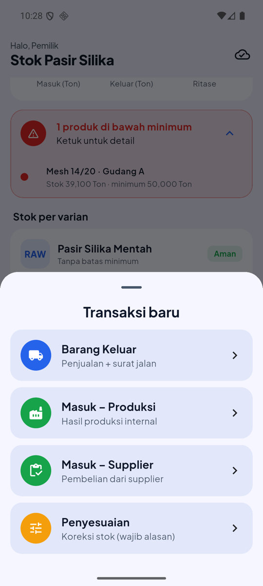
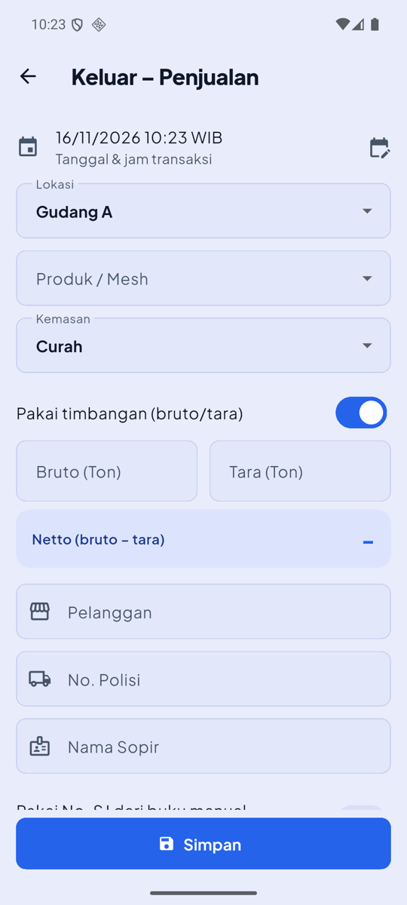
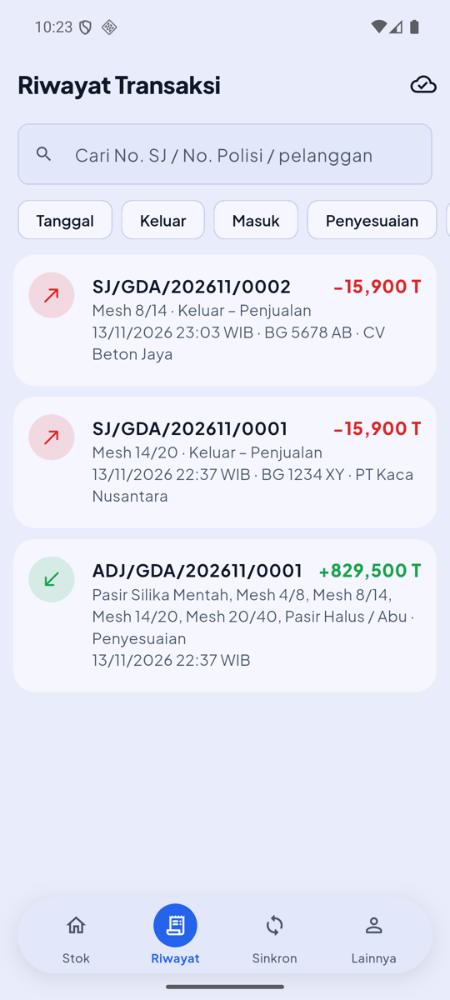
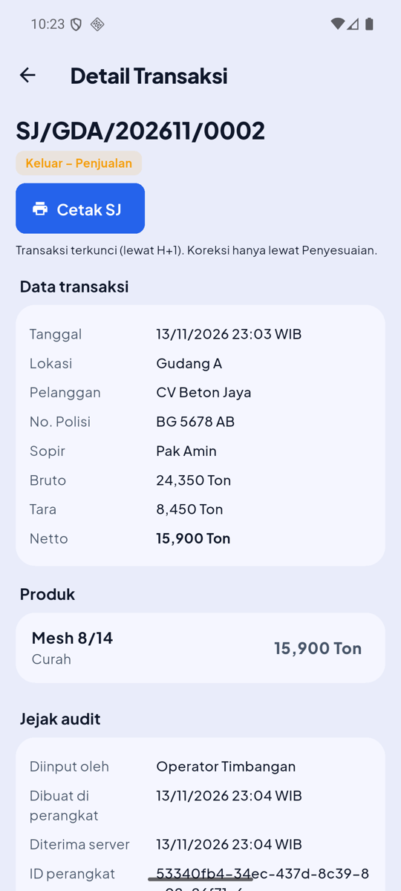
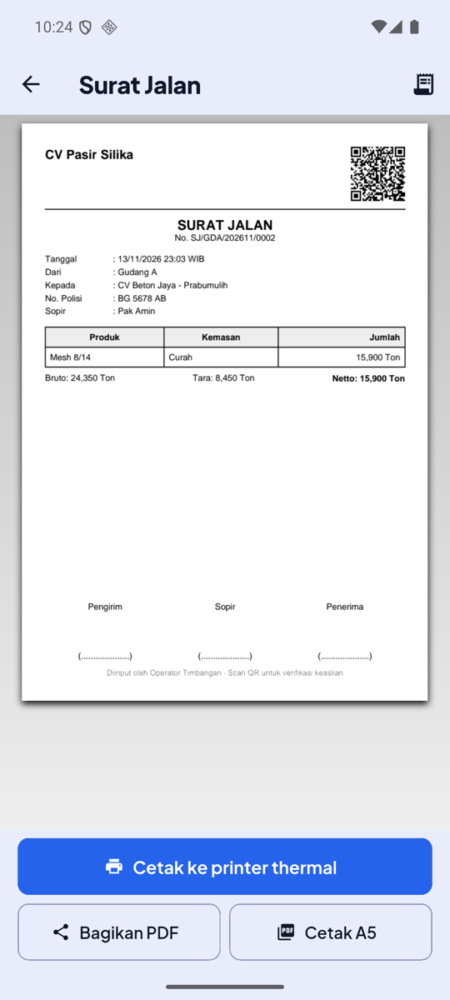
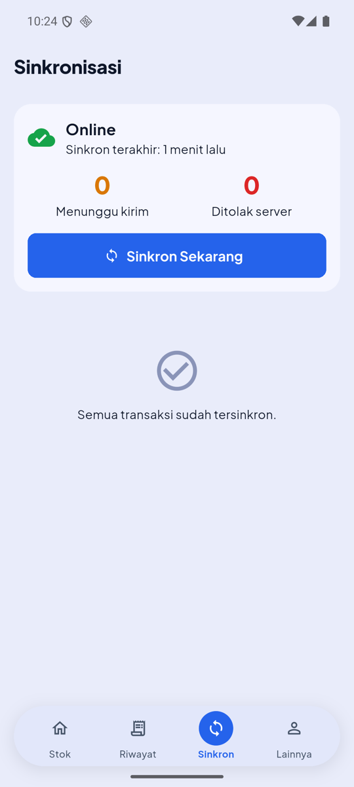

# Aplikasi Management Pasir Silika — MVP (Fase 1)

Implementasi PRD "Aplikasi Management Pasir Silika" v1.0: aplikasi Flutter (Android) + REST API NestJS + MySQL 8.

```
Inventory-app/
├── backend/   NestJS 11 · Prisma 6 · MySQL 8 · JWT · RBAC
└── app/       Flutter 3.44 · Riverpod 3 · go_router · Dio · drift + SQLCipher
```

## Tampilan aplikasi

<p>




</p>
<p>




</p>

| # | Layar | Rute | Akses |
|---|---|---|---|
| 1 | Login | `/login` | Semua |
| 2 | Dashboard Stok | `/` | Semua |
| 3 | Pilih Jenis Transaksi | sheet dari **+ Transaksi** | Owner, Admin, Operator |
| 4 | Form Transaksi (Keluar / Masuk / Penyesuaian) | `/trx/new/:type`, `/trx/edit/:id` | Owner, Admin, Operator |
| 5 | Riwayat Transaksi | `/history` | Semua |
| 6 | Detail Transaksi + jejak audit | `/trx/:key` | Semua |
| 7 | Cetak Surat Jalan (thermal / PDF A5) | `/trx/:key/print` | Owner, Admin, Operator |
| 8 | Sinkronisasi | `/sync` | Semua |
| 9 | Lainnya (pengaturan) | `/more` | Semua |
| 10 | Master Data (produk, lokasi, kemasan, pelanggan, kendaraan, stok minimum) | `/master`, `/master/:entity` | Owner, Admin |
| 11 | Manajemen User | `/users` | Owner |
| 12 | Profil Perusahaan & Aturan | `/settings/company` | Owner, Admin |
| 13 | Printer Bluetooth | `/settings/printer` | Owner, Admin, Operator |

📖 Penjelasan lengkap setiap layar beserta screenshot: **[docs/SCREENS.md](docs/SCREENS.md)**

## Menjalankan (development)

### 1. Backend
```bash
cd backend
cp .env.example .env          # isi DATABASE_URL & JWT_SECRET
npm install
npx prisma migrate deploy     # buat tabel + trigger append-only
npm run seed -- --demo        # master data, 4 user, saldo awal demo (via ledger)
npm run start:dev             # http://localhost:3000/api/v1
```

Login awal (ganti password setelah go-live):

| Role | Username | Password |
|---|---|---|
| Owner | `owner` | `owner12345` |
| Admin | `admin` | `admin12345` |
| Operator (Gudang A) | `operator` | `operator123` |
| Viewer/Akuntan | `viewer` | `viewer12345` |

### 2. Aplikasi Flutter
```bash
cd app
flutter pub get
dart run build_runner build        # generate kode drift (sekali / setelah ubah tabel)
flutter run --dart-define=API_BASE_URL=http://10.0.2.2:3000/api/v1   # emulator
# HP fisik: pakai IP komputer, mis. http://192.168.1.10:3000/api/v1
```
Alamat server juga bisa diubah dari layar login → "Pengaturan server".

### 3. Pengujian
```bash
cd backend && npm run test:e2e     # 15 skenario posting stok (DB: pasir_silika_test)
cd app && flutter test             # presisi desimal, format, status stok, efek offline
cd backend && npm run db:reconcile # rekonsiliasi saldo vs ledger (jadwalkan via cron harian)
```
E2E test tidak menghapus data (memakai kode unik per run), jadi aman diulang. Untuk
mengosongkan DB test secara manual: `dotenv-cli -e .env.test -- npx prisma migrate reset`.

## Yang sudah diimplementasikan (MVP / P0)

| PRD | Status |
|---|---|
| FR-01 Auth: JWT 1 jam + refresh 30 hari (rotasi), sesi tetap jalan offline, user nonaktif langsung 401, bcrypt, kunci 15 menit setelah 5× gagal | ✅ |
| FR-02 Dashboard: total & per mesh, hijau/kuning(≤120%)/merah, ringkasan hari ini, auto-refresh 30 dtk, "Data per …" saat offline + efek transaksi lokal | ✅ |
| FR-03 Masuk/Keluar/Penyesuaian: bruto/tara/netto, kemasan→ton, No. Polisi otomatis, foto ≤500 KB, nomor `SJ/{LOK}/{YYYYMM}/{0001}`, validasi stok negatif (override Owner), peringatan input ganda 15 menit, batas wajar per truk | ✅ |
| FR-04 Riwayat (infinite scroll, filter, cari), detail + jejak audit, void dengan mutasi pembalik, Admin "ajukan void", kunci H+1, tanpa hapus permanen (dijaga trigger DB) | ✅ |
| FR-09 Stok minimum per produk per lokasi + banner merah | ✅ (push notif = Fase 2) |
| FR-10 Surat jalan: printer thermal Bluetooth ESC/POS 58/80 mm, PDF A5, bagikan WhatsApp, QR verifikasi publik, cetak ulang "COPY" + audit | ✅ |
| FR-11 Offline: antrian SQLite terenkripsi, badge pending di app bar, sinkron otomatis (koneksi kembali, tiap 5 menit, WorkManager 15 menit) + "Sinkron Sekarang", idempoten via `client_uuid` | ✅ |
| FR-12 Master data (produk, lokasi, kemasan, pelanggan/supplier, kendaraan, stok minimum, profil perusahaan) | ✅ |
| Manajemen user (Owner), audit log, RBAC di setiap endpoint | ✅ |

## Keputusan desain penting

- **Ledger append-only.** Setiap perubahan stok = baris `stock_ledger`; `stock_balances` adalah cache yang
  dikunci `SELECT … FOR UPDATE` (urut `product_id`). Trigger MySQL menolak UPDATE/DELETE pada ledger dan
  DELETE pada transaksi. Edit transaksi = ledger pembalik + ledger baru (item lama ditandai `superseded_at`).
- **Anti-deadlock.** Baris saldo & nomor dokumen dibuat di luar transaksi sebelum dikunci; di dalam transaksi
  hanya ada exclusive lock berurutan. Teruji 10 request paralel → tepat 7 sukses, stok tidak negatif.
- **Online vs offline.** Saat online, form mengirim langsung ke `POST /transactions` agar error stok tampil
  interaktif. Saat offline/jaringan putus → antrian lokal → `/sync/push`; jika stok server kurang, transaksi
  tetap diterima sebagai `pending_approval` (truk sudah berangkat) untuk ditinjau Admin/Owner.
- **Nomor SJ offline** `TMP-{device}-{urut}`; QR memakai `client_uuid` sehingga SJ cetak offline tetap bisa
  diverifikasi setelah tersinkron.
- **Presisi.** `DECIMAL(14,3)` di MySQL, `decimal.js` di backend, package `decimal` di Flutter, tonase dikirim
  sebagai string.
- Tambahan kolom vs DDL PRD: `partner_name` (snapshot, pelanggan baru bisa diketik saat offline),
  `void_requested_*`, `review_note`, `verify_token`, `print_count`, `transaction_items.direction/superseded_at`,
  `refresh_tokens`, `users.failed_login_count/locked_until`.

## Belum dikerjakan / perlu perhatian

- **Fase 2+** sesuai PRD: produksi/ayakan, opname & penyusutan (tabel sudah disiapkan), transfer antar lokasi,
  ekspor Excel/PDF, push notification FCM & ringkasan harian 07.00, integrasi timbangan.
- PIN/biometrik (opsional di FR-01) dan kunci "tutup buku bulanan" belum ada (kunci H+1 sudah).
- Belum diuji di perangkat nyata: printer thermal Bluetooth, unggah foto, sinkron background WorkManager.
  Alur login → dashboard → input keluar **offline** → cetak SJ → sinkron otomatis sudah diuji di emulator Android 16.
- Rilis: ganti `JWT_SECRET`, pasang HTTPS (build rilis menolak HTTP), buat keystore rilis
  (`app/android/app/build.gradle.kts`), dan jadwalkan `npm run db:reconcile` + backup MySQL harian.
- `permission_handler` dipin ke 12.x karena 13.x butuh platform `android-37` yang belum terpasang di SDK lokal.
