# Dokumentasi Layar Aplikasi

Screenshot diambil dari emulator Android (1080×2400) dengan data demo (`npm run seed -- --demo`),
login sebagai **Owner**. Beberapa menu hanya muncul untuk peran tertentu; lihat kolom *Akses*.

| Peran | Singkatan |
|---|---|
| Owner | O |
| Admin (Kepala Gudang) | A |
| Operator Timbangan | Op |
| Viewer / Akuntan | V |

Navigasi utama memakai bottom nav berbentuk pill dengan 4 tab: **Stok · Riwayat · Sinkron · Pengaturan**.
Tombol **back** di tab Riwayat, Sinkron, atau Pengaturan kembali ke tab **Stok**; back di tab Stok menutup aplikasi.
Tombol **+ Transaksi** ada di tab Stok.

---

## 1. Login

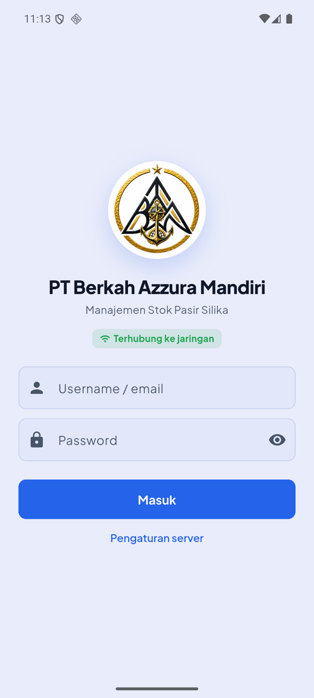

| | |
|---|---|
| Rute | `/login` |
| Akses | Semua |
| Kode | `app/lib/features/auth/login_screen.dart` |

- Masuk dengan **username atau email** dan password.
- Logo dan nama **PT Berkah Azzura Mandiri** di bagian atas (logo sama dengan ikon aplikasi).
- Indikator koneksi (*Terhubung ke jaringan* / *Offline*) di atas form.
- **Pengaturan server**: mengganti alamat API, misalnya untuk HP fisik di jaringan lokal.
- Akun terkunci 15 menit setelah 5× salah password (diatur di backend).
- **Sesi tanpa batas waktu**: setelah login, user tetap masuk walaupun app ditutup, HP di-restart,
  atau offline, sampai menekan **Keluar** atau dinonaktifkan Owner. Diatur dengan `REFRESH_TOKEN_DAYS=0` di backend.

---

## 1b. Kunci Biometrik

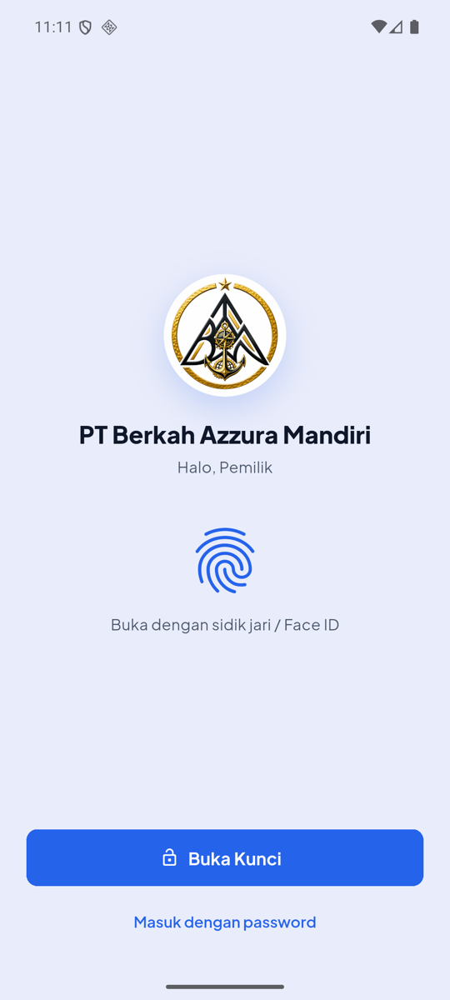

| | |
|---|---|
| Rute | lapisan di atas semua layar (bukan rute) |
| Akses | Semua user yang sudah login |
| Kode | `app/lib/features/auth/app_lock.dart` |

- Jika aplikasi ditinggal **≥ 5 menit** (pindah ke app lain, layar mati, atau app ditutup), app terkunci
  saat dibuka lagi dan meminta **sidik jari / Face ID** dari HP.
- Jika biometrik gagal atau tidak bisa dipakai, sistem HP menawarkan **PIN / pola layar** sebagai cadangan.
- **Masuk dengan password** di layar kunci: keluar dari akun lalu login ulang dengan username & password.
  Tetap ditolak jika masih ada transaksi belum tersinkron, supaya data tidak hilang.
- Jika HP belum punya sidik jari / kunci layar, app tidak dikunci.
- Bisa dimatikan di **Pengaturan → Kunci dengan sidik jari / Face ID** (default aktif).

---

## 2. Dashboard Stok

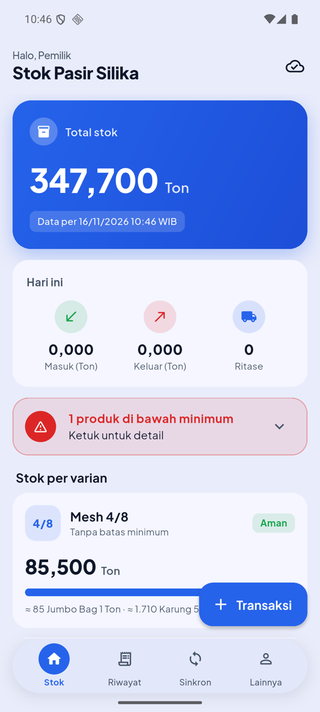 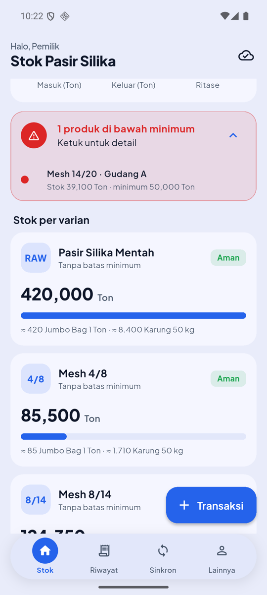

| | |
|---|---|
| Rute | `/` (tab **Stok**) |
| Akses | Semua (pilihan lokasi baru muncul jika ada lebih dari 1 gudang aktif) |
| Kode | `app/lib/features/dashboard/dashboard_screen.dart` |

- **Kartu Total stok** (gradien biru): total ton keempat jenis pasir dan waktu data terakhir ("Data per …").
- **Hari ini**: total masuk, keluar (ton) dan jumlah ritase.
- **Banner merah** jika ada produk di bawah stok minimum. Ketuk untuk melihat produk dan lokasinya.
- **Stok per varian**: Mesh 4/8, 8/14, 14/20, 20/40. Tiap mesh menampilkan ton, status (*Aman* / *Menipis* / *Kritis*),
  progress bar terhadap batas minimum, dan konversi ke kemasan (Jumbo Bag, karung).
- Owner/Admin melihat tombol pintas **Perlu ditinjau** dan **Pengajuan void** jika ada.
- Saat offline, angka tetap tampil dari cache lokal ditambah efek transaksi yang belum tersinkron.
- Auto-refresh tiap 30 detik. Ikon awan di kanan atas membuka status sinkron.

---

## 3. Pilih Jenis Transaksi

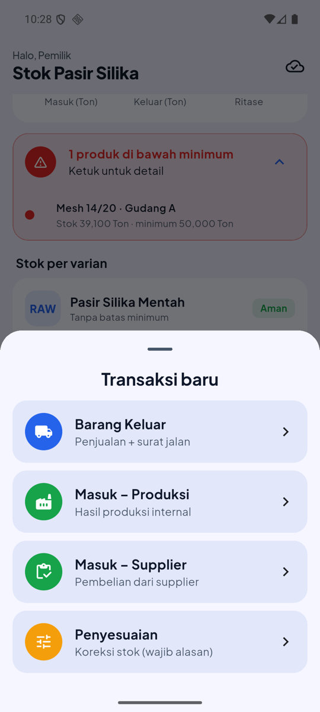

| | |
|---|---|
| Rute | bottom sheet dari tombol **+ Transaksi** |
| Akses | O, A, Op (Penyesuaian hanya O & A) |
| Kode | `app/lib/features/transactions/trx_type_sheet.dart` |

Tombol besar untuk empat jenis transaksi:

- **Barang Keluar**: penjualan, sekaligus menghasilkan surat jalan.
- **Masuk – Produksi**: hasil produksi internal.
- **Masuk – Supplier**: pembelian dari supplier.
- **Penyesuaian**: koreksi stok, alasan wajib diisi.

---

## 4. Form Transaksi

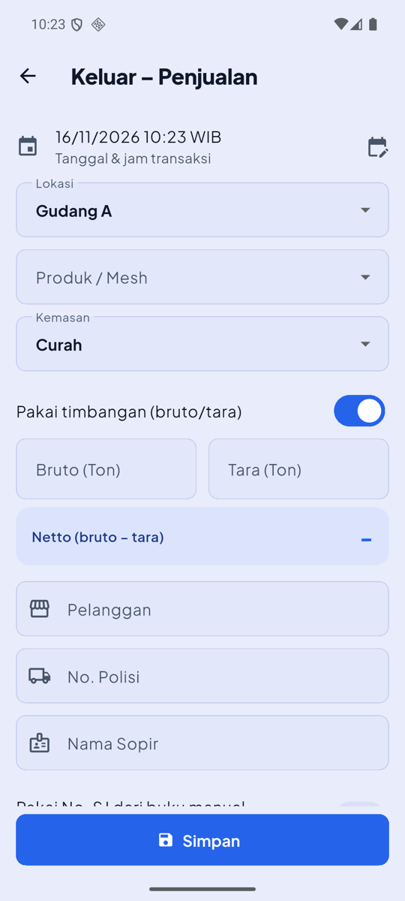 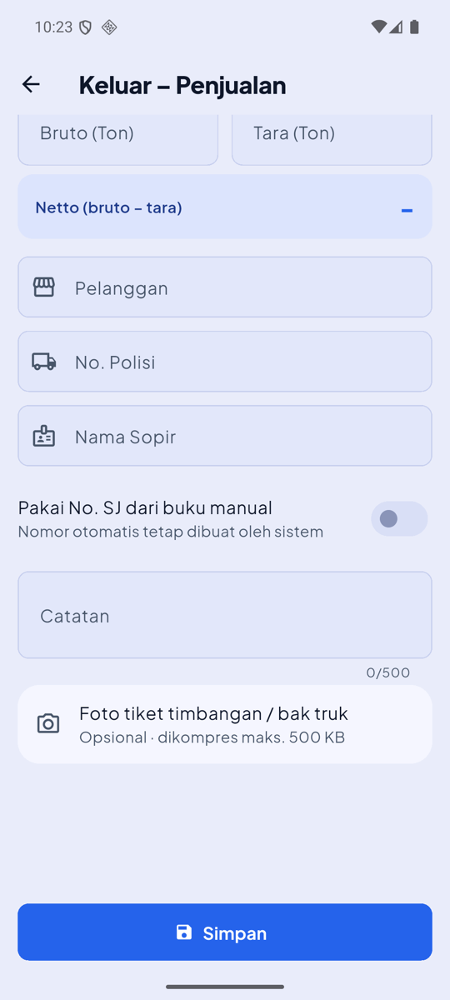

| | |
|---|---|
| Rute | `/trx/new/:type`, `/trx/edit/:id` |
| Akses | O, A, Op |
| Kode | `app/lib/features/transactions/trx_form_screen.dart` |

- **Tanggal & jam transaksi** (default sekarang), **Lokasi**, **Produk / Mesh**, **Kemasan**.
- **Pakai timbangan**: isi Bruto dan Tara, lalu Netto dihitung otomatis. Jika dimatikan, isi jumlah
  per kemasan dan sistem mengonversinya ke ton.
- Khusus barang keluar: **Pelanggan**, **No. Polisi** (dinormalisasi otomatis, mis. `bg1234xy` → `BG 1234 XY`),
  **Nama Sopir**, dan opsi **No. SJ dari buku manual**.
- **Catatan** (maks. 500 karakter) dan **Foto tiket timbangan / bak truk** (dikompres ≤ 500 KB).
- Validasi: stok tidak boleh negatif (Owner bisa override), peringatan input ganda untuk No. Polisi
  yang sama dalam 15 menit, dan batas wajar tonase per truk.
- **Simpan** selalu menyimpan ke database lokal terlebih dulu. Saat offline transaksi mendapat nomor
  sementara `TMP-…`, lalu nomor resmi `SJ/{LOK}/{YYYYMM}/{0001}` diberikan server ketika sinkron.

---

## 5. Riwayat Transaksi

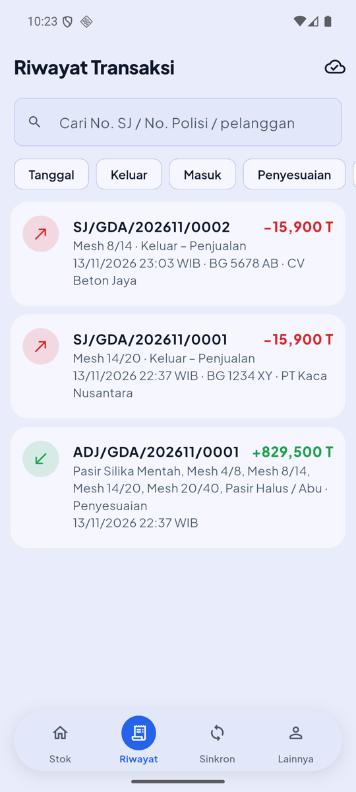

| | |
|---|---|
| Rute | `/history` (tab **Riwayat**) |
| Akses | Semua |
| Kode | `app/lib/features/transactions/history_screen.dart` |

- **Cari** berdasarkan No. SJ, No. Polisi, atau nama pelanggan.
- **Filter chip**: Tanggal (rentang), Keluar, Masuk, Penyesuaian, Void, Produk.
  Owner/Admin juga punya **Perlu ditinjau** dan **Pengajuan void**.
- Infinite scroll (20 per halaman) dan tarik ke bawah untuk refresh.
- Transaksi yang belum tersinkron tampil di bagian atas dengan label *Belum tersinkron*.
- Saat offline, daftar diambil dari transaksi yang tersimpan di perangkat.

---

## 6. Detail Transaksi

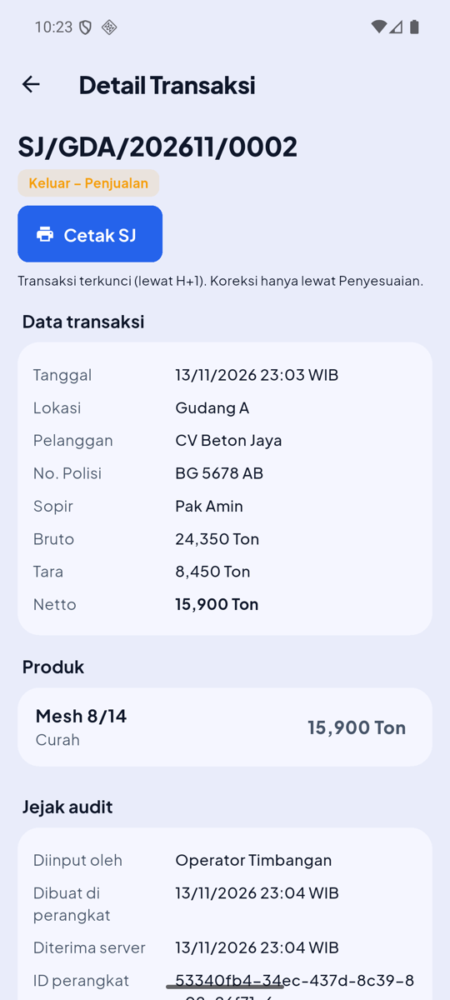 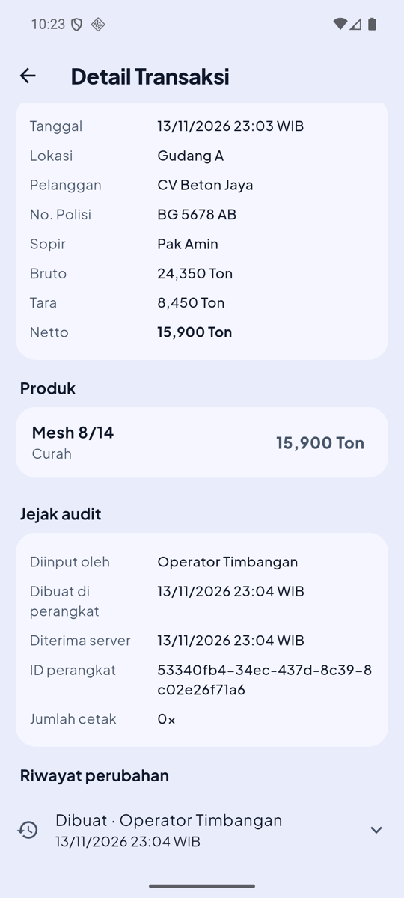

| | |
|---|---|
| Rute | `/trx/:key` |
| Akses | Semua (tombol aksi sesuai peran) |
| Kode | `app/lib/features/transactions/detail_screen.dart` |

- Nomor dokumen, jenis, status (VOID, Perlu ditinjau, Diajukan void, Ditolak server).
- **Data transaksi**: tanggal, lokasi, pelanggan, No. Polisi, sopir, bruto/tara/netto.
- **Produk**: daftar item dan ton.
- **Jejak audit**: penginput, waktu dibuat di perangkat, waktu diterima server, ID perangkat,
  jumlah cetak, dan **riwayat perubahan**.
- Aksi:
  - **Cetak SJ / Cetak ulang SJ**, untuk barang keluar.
  - **Perbaiki** atau **Kirim ulang**, untuk transaksi lokal yang belum tersinkron atau ditolak server.
  - **Edit**, sebelum transaksi terkunci (H+1). Setelah itu koreksi hanya lewat Penyesuaian.
  - **Setujui**, khusus Owner, untuk transaksi yang diterima saat stok server tidak cukup.
  - **Void** (Owner) atau **Ajukan void** (Admin). Void membuat mutasi pembalik dan tidak pernah menghapus data.

---

## 7. Cetak Surat Jalan

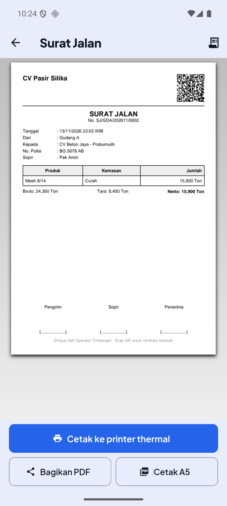

| | |
|---|---|
| Rute | `/trx/:key/print` |
| Akses | O, A, Op |
| Kode | `app/lib/features/delivery_note/print_screen.dart`, `delivery_note_pdf.dart`, `thermal_printer.dart` |

- **Kop surat jalan: logo PT di kiri dan nama PT (*PT Berkah Azzura Mandiri*) di sampingnya**, berlaku untuk
  PDF A5 di HP, PDF dari server, dan cetakan printer thermal (kop dicetak sebagai gambar).
- Pratinjau surat jalan A5 dengan kop perusahaan, data pengiriman, tabel produk, kolom tanda tangan,
  dan **QR verifikasi**. QR membuka halaman publik `/api/v1/verify/...` untuk mengecek keaslian SJ.
- **Cetak ke printer thermal** (Bluetooth ESC/POS 58/80 mm), **Bagikan PDF** (mis. ke WhatsApp), **Cetak A5**.
- Cetakan kedua dan seterusnya diberi tanda **COPY** dan dicatat di jejak audit.

---

## 8. Sinkronisasi

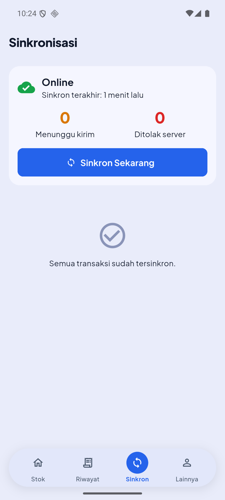

| | |
|---|---|
| Rute | `/sync` (tab **Sinkron**) |
| Akses | Semua |
| Kode | `app/lib/features/sync_status/sync_status_screen.dart`, `app/lib/sync/` |

- Status **Online/Offline** dan waktu sinkron terakhir.
- Jumlah transaksi **Menunggu kirim** dan **Ditolak server**, beserta daftarnya. Ketuk untuk membuka detail.
- **Sinkron Sekarang** untuk sinkron manual. Sinkron otomatis berjalan saat koneksi kembali, tiap 5 menit
  saat aplikasi terbuka, dan tiap 15 menit di latar belakang (WorkManager).
- Pengiriman idempoten lewat `client_uuid`, jadi transaksi yang terkirim dua kali tidak tercatat ganda.

---

## 9. Pengaturan

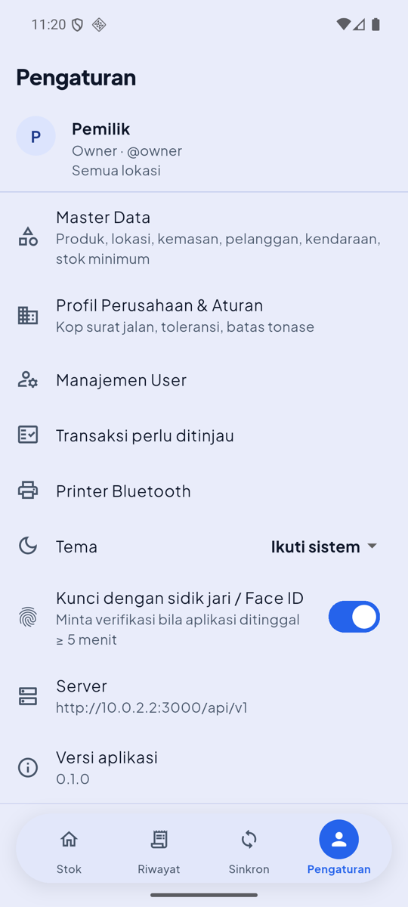

| | |
|---|---|
| Rute | `/more` (tab **Pengaturan**) |
| Akses | Semua (menu sesuai peran) |
| Kode | `app/lib/features/settings/settings_screen.dart` |

- Kartu profil: nama, peran, username, lokasi yang ditugaskan.
- Menu: **Master Data** dan **Profil Perusahaan & Aturan** (O, A), **Manajemen User** (Owner),
  **Transaksi perlu ditinjau** (O, A), **Printer Bluetooth** (O, A, Op).
- **Kunci dengan sidik jari / Face ID** (aktif/nonaktif), **Server** (alamat API), **Tema** (Ikuti sistem / Terang / Gelap), **Versi aplikasi**, dan **Keluar**.

---

## 10. Master Data

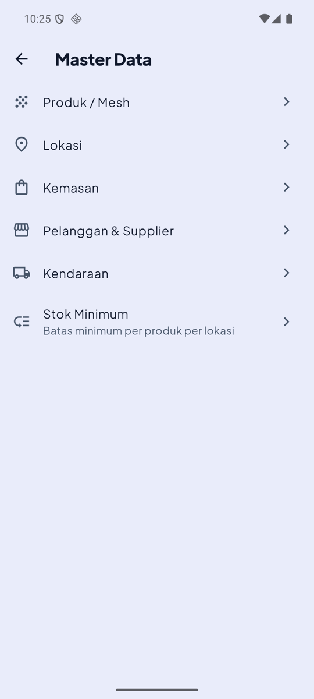

| | |
|---|---|
| Rute | `/master` |
| Akses | O, A |
| Kode | `app/lib/features/master_data/master_screens.dart` |

Menu ke enam master data berikut. Data diarsipkan (tidak dihapus) agar riwayat transaksi tetap utuh.

### 10.1 Produk / Mesh · 10.2 Gudang / Lokasi · 10.3 Kemasan

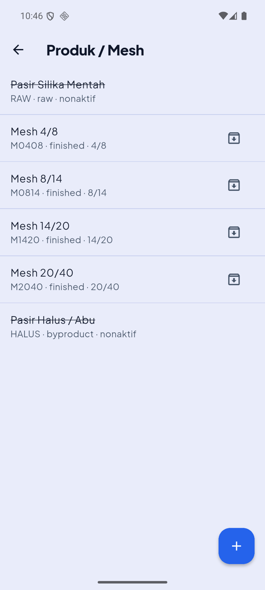 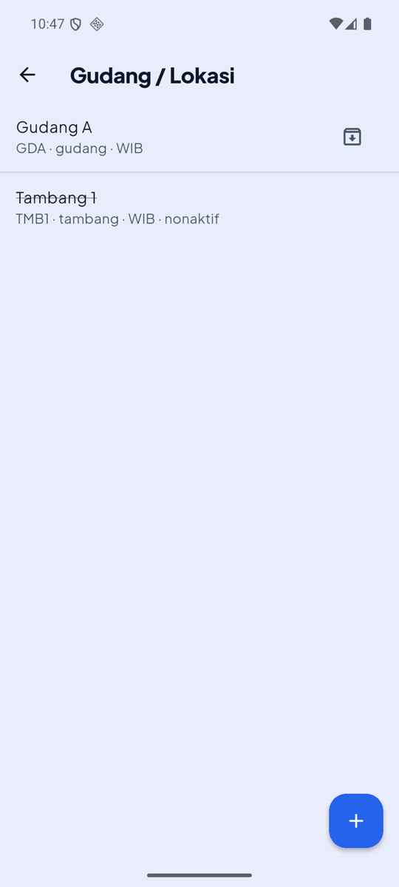 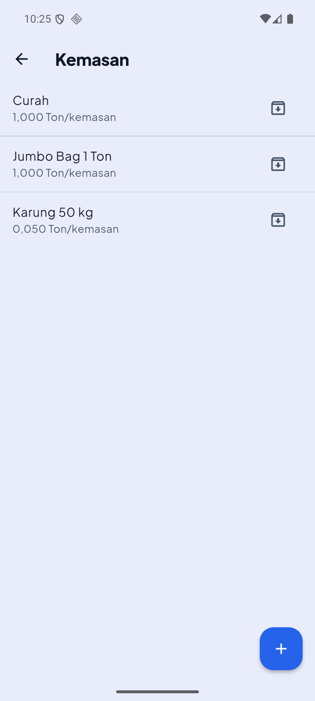

- **Produk / Mesh**: 4 jenis pasir silika, yaitu Mesh 4/8, 8/14, 14/20, 20/40. Field: kode (mis. `M1420`),
  nama, ukuran mesh, kategori, densitas (Ton/m³), urutan tampil.
- **Gudang / Lokasi** (khusus Owner): saat ini hanya ada 1 gudang (*Gudang A*, kode `GDA`).
  Gudang baru ditambah lewat tombol **+**: kode (dipakai di nomor SJ, mis. `GDB` → `SJ/GDB/…`),
  nama, tipe (default Gudang), alamat, zona waktu. Setelah dibuat, Owner memberi akses ke Admin/Operator
  lewat **Manajemen User**. Begitu ada lebih dari 1 gudang aktif, pilihan lokasi otomatis muncul di dashboard.
- **Kemasan**: nama (Curah, Jumbo Bag 1 Ton, Karung 50 kg), ton per kemasan, curah atau tidak.
- Tombol **+** untuk menambah, ikon arsip untuk menonaktifkan.

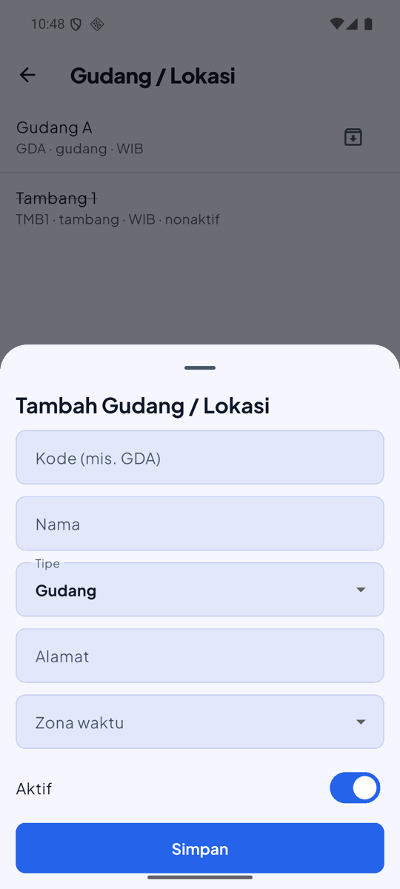

*Form tambah gudang (Owner).*

### 10.4 Pelanggan & Supplier · 10.5 Kendaraan · 10.6 Stok Minimum

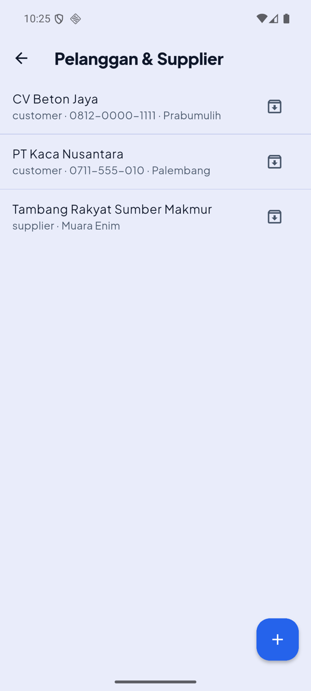 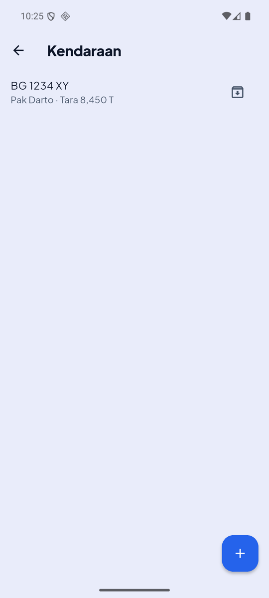 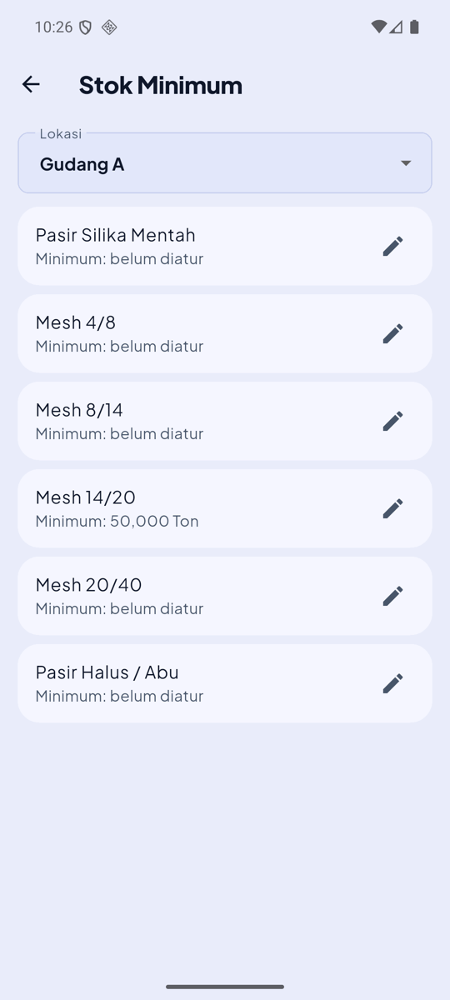

- **Pelanggan & Supplier**: jenis (pelanggan/supplier), nama, telepon, alamat.
- **Kendaraan**: No. Polisi, sopir default, dan tara standar (Ton), dipakai untuk isian otomatis di form.
- **Stok Minimum**: batas minimum per produk per lokasi. Batas ini menentukan status Aman/Menipis/Kritis
  dan banner merah di dashboard.

---

## 11. Manajemen User

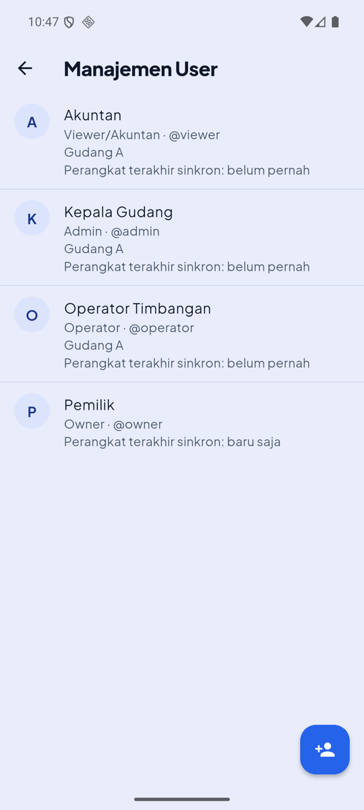

| | |
|---|---|
| Rute | `/users` |
| Akses | Owner |
| Kode | `app/lib/features/users/users_screen.dart` |

- Daftar user dengan peran, username, lokasi yang ditugaskan, dan **waktu sinkron terakhir perangkat**,
  untuk mendeteksi HP yang lama tidak sinkron.
- Tombol **+** untuk menambah user (nama, username, email opsional, password min. 8 karakter, role, lokasi).
  Operator hanya boleh ditugaskan ke 1 lokasi.
- Ketuk user untuk mengubah data atau mengganti password. **Nonaktifkan** membuat user langsung keluar
  dari semua perangkat.

---

## 12. Profil Perusahaan & Aturan

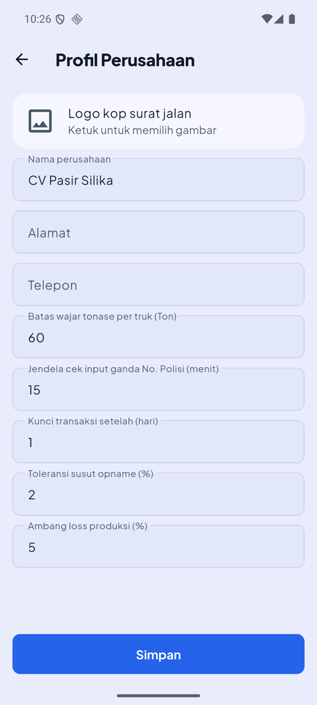

| | |
|---|---|
| Rute | `/settings/company` |
| Akses | O, A |
| Kode | `app/lib/features/settings/settings_screen.dart` |

- **Logo kop surat jalan**, nama perusahaan, alamat, telepon (tampil di surat jalan).
  Jika logo belum diunggah, dipakai logo PT bawaan (`app/assets/branding/logo.png` dan `backend/assets/logo.png`).
- Aturan bisnis:
  - **Batas wajar tonase per truk** (Ton): input di atas batas ini memunculkan peringatan.
  - **Jendela cek input ganda No. Polisi** (menit).
  - **Kunci transaksi setelah** (hari): setelah lewat, edit tidak diizinkan.
  - **Toleransi susut opname** (%) dan **Ambang loss produksi** (%), disiapkan untuk Fase 2.

---

## 13. Printer Bluetooth

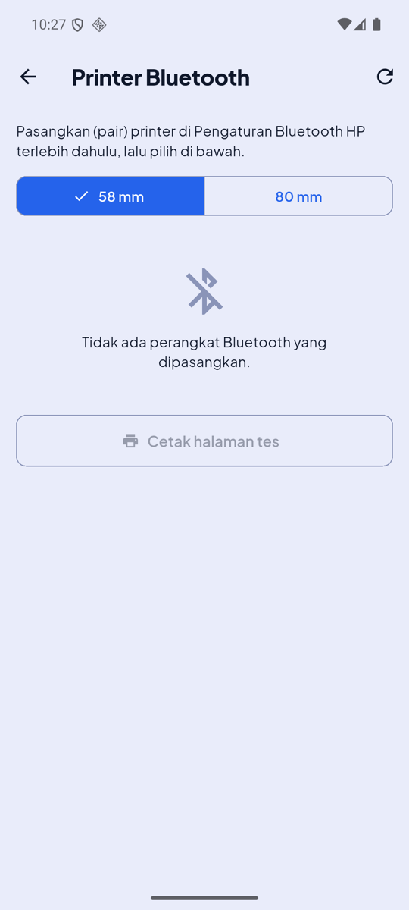

| | |
|---|---|
| Rute | `/settings/printer` |
| Akses | O, A, Op |
| Kode | `app/lib/features/settings/printer_settings_screen.dart` |

- Pilih lebar kertas **58 mm** atau **80 mm**.
- Daftar printer Bluetooth yang sudah di-*pair* di pengaturan HP. Pilih salah satu sebagai printer default.
- **Cetak halaman tes** untuk memastikan printer berfungsi.
- Meminta izin *Nearby devices* (Bluetooth) saat pertama dibuka.

---

# Admin Panel (web)

Admin panel berbasis web (NestJS + Handlebars) berjalan di server yang sama dengan API:
**`https://<domain-api>/admin-panel/`**. Khusus **Owner** dan **Admin**; Operator & Viewer
memakai aplikasi di HP. Semua aksi memakai aturan bisnis & jejak audit yang sama dengan API.

| Halaman | Rute | Akses | Isi |
|---|---|---|---|
| Login | `/admin-panel/login` | Owner, Admin | Sesi cookie 12 jam; kunci 15 menit setelah 5× gagal (sama dengan app) |
| Dashboard | `/admin-panel` | Owner, Admin | Total stok, stok per mesh & per lokasi, peringatan stok minimum, ringkasan hari ini, antrian persetujuan & ajuan void, transaksi terbaru |
| Transaksi | `/admin-panel/trx` | Owner, Admin | Filter tanggal/jenis/status/lokasi/cari, halaman, ekspor CSV |
| Detail transaksi | `/admin-panel/trx/:id` | Owner, Admin | Rincian, barang, jejak audit, unduh surat jalan PDF, foto; **Setujui** (pending), **VOID** (Owner) / **Ajukan void** (Admin) |
| Laporan | `/admin-panel/reports` | Owner, Admin | Mutasi per jenis pasir, penjualan per pelanggan, rekap harian, cetak, ekspor CSV (`;` + desimal koma, siap Excel) |
| Data Master | `/admin-panel/master/:entity` | Owner, Admin (Gudang: Owner) | Produk (ubah saja), gudang, kemasan, pelanggan & supplier, kendaraan |
| Stok Minimum | `/admin-panel/min-levels` | Owner, Admin | Tabel produk × lokasi |
| Manajemen User | `/admin-panel/users` | Owner | Tambah/ubah user, role, lokasi, reset password, nonaktifkan, buka kunci login |
| Jejak Audit | `/admin-panel/audit` | Owner, Admin | Filter entitas/aksi/user, nilai sebelum & sesudah |
| Pengaturan | `/admin-panel/settings` | Owner, Admin | Profil perusahaan, aturan (batas netto, kunci H+1, dll.), unggah logo kop surat jalan |

Keamanan: cookie `httpOnly` + `SameSite=Strict` (path `/admin-panel`), POST dari origin lain ditolak,
sesi otomatis batal bila user dinonaktifkan atau password diganti.

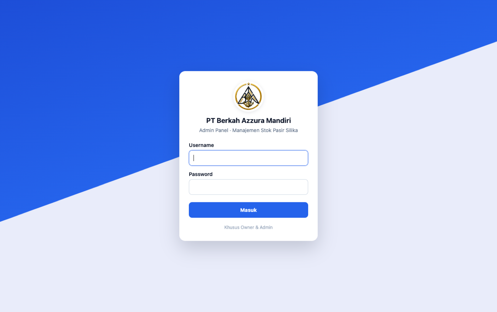
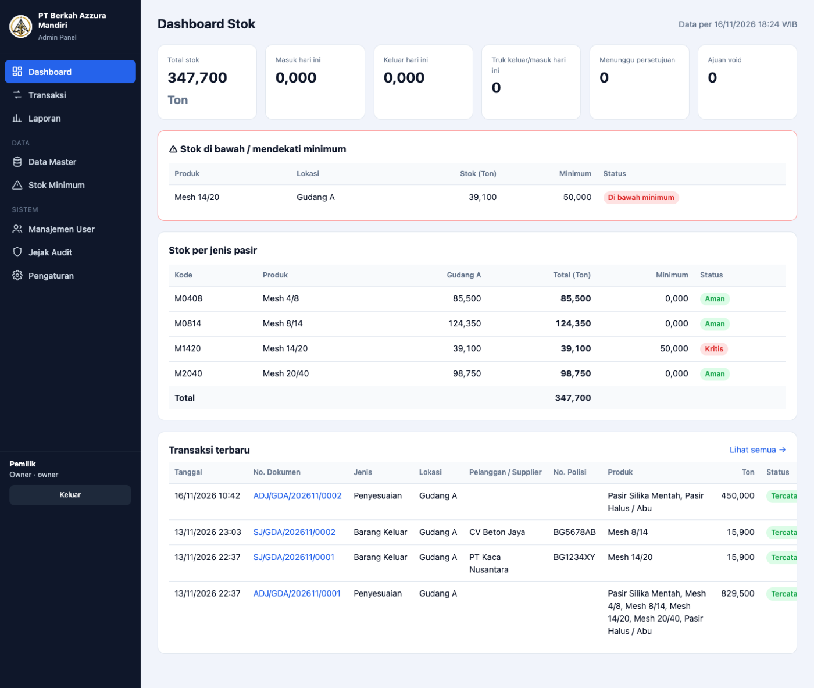

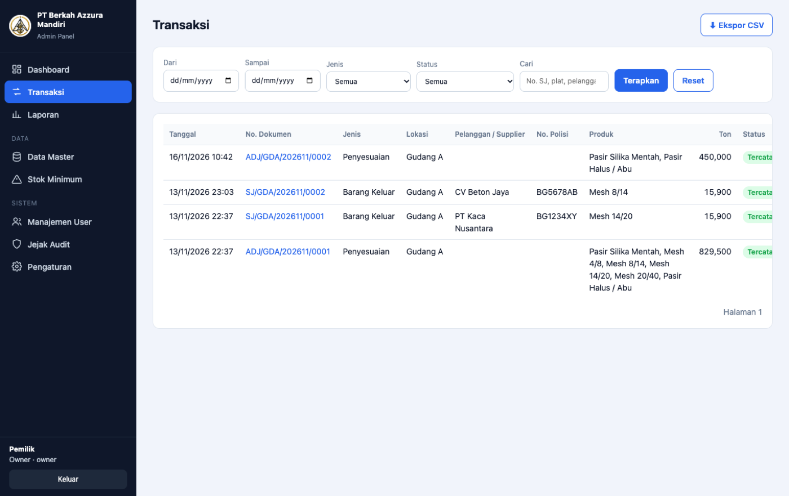
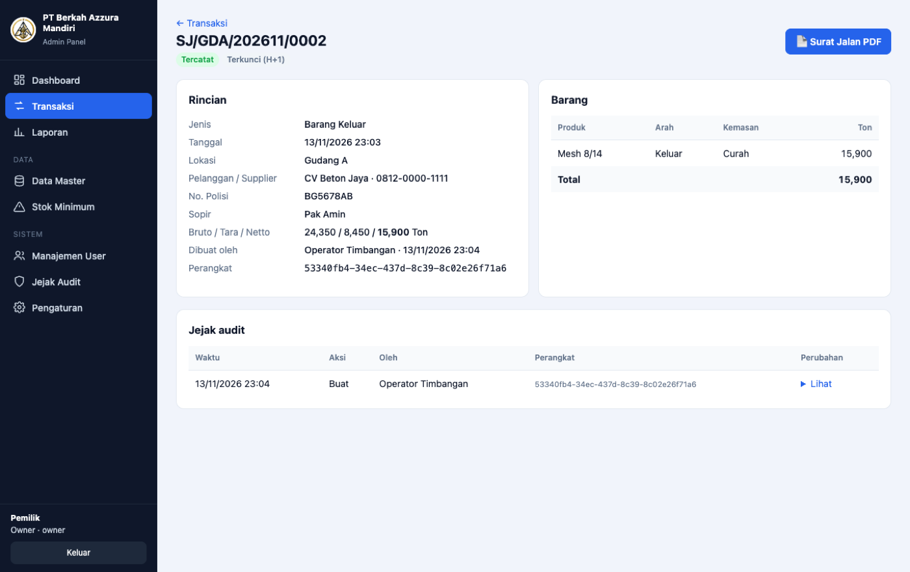

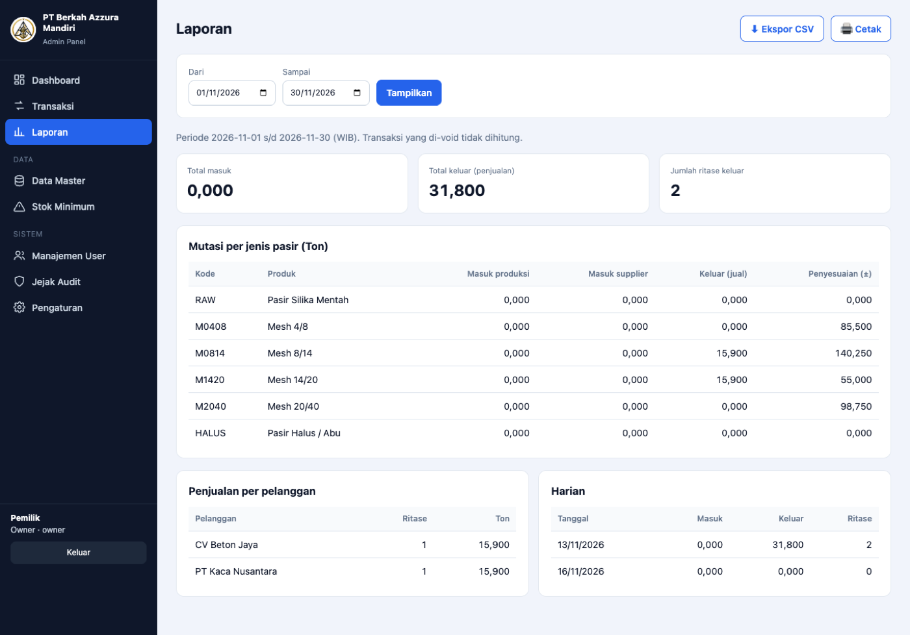
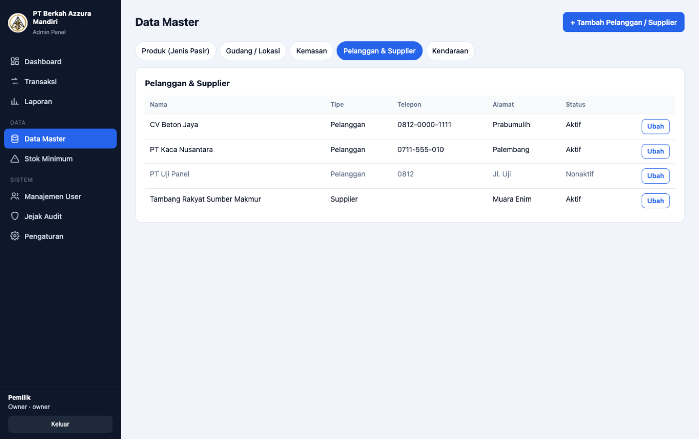

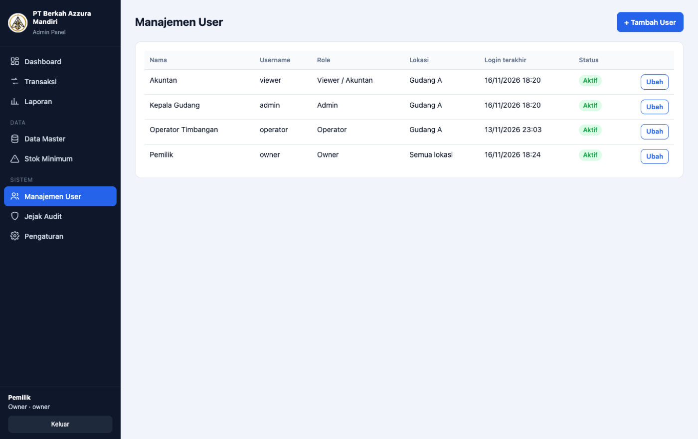
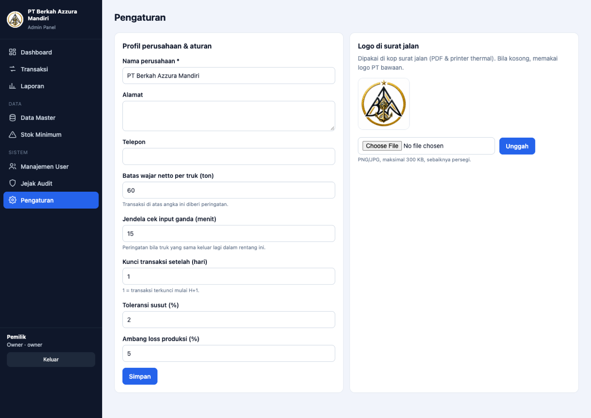

